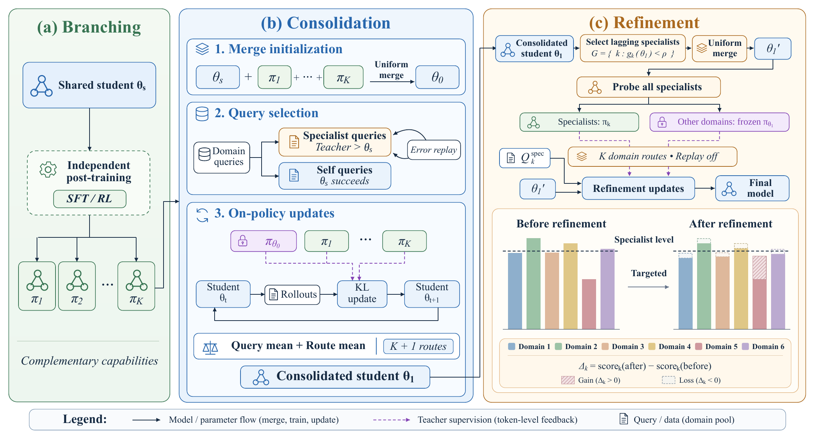

# Branch and Consolidate

## A Unified Recipe for Multi-Teacher On-Policy Distillation

[](https://arxiv.org/abs/2611.32515)
[](https://arxiv.org/pdf/2611.32515)
[](LICENSE)

Zihan Liang, Zikun Qu, Ben Chen, Fan Yang, Wenwu Ou, Min Zhang, Zhongxiang Dai, and Xinchao Wang

**Consolidate divergent specialists into a shared student through merged initialization, selected queries, error replay, and balanced distillation, then refine the remaining capability gaps.**



The paper studies specialists post-trained from a common checkpoint. Stage 1 consolidates their capabilities with a frozen self teacher to preserve existing behavior. Stage 2 re-merges selected specialists and assigns specialist or self supervision per domain using validation recovery and Top-32 overlap.

## What is available

This release provides the initial three-specialist implementation, reusable algorithm modules, and a reference configuration.

| Component | Source |
|---|---|
| Equal-weight checkpoint merging | [`weight_average/average_many.py`](weight_average/average_many.py) |
| Query selection and data interfaces | [`opd/candidates.py`](opd/candidates.py), [`opd/data.py`](opd/data.py) |
| Online error replay and resumable sampling | [`opd/online_sampling.py`](opd/online_sampling.py), [`opd/sampling.py`](opd/sampling.py) |
| Query-mean and route-mean aggregation | [`opd/balanced.py`](opd/balanced.py) |
| Top-32 plus tail reverse KL and overlap statistics | [`opd/losses.py`](opd/losses.py) |
| Student rollout and frozen-teacher scoring | [`opd/loops.py`](opd/loops.py) |
| Correctness feedback for replay | [`opd/feedback.py`](opd/feedback.py) |
| Reference VERL integration | [`opd/native.py`](opd/native.py), [`opd/trainer.py`](opd/trainer.py), [`opd/train.py`](opd/train.py) |
| Three-specialist reference configuration | [`configs/three_specialists.template.json`](configs/three_specialists.template.json) |

| Setting or workflow | Release status |
|---|---|
| Three specialists plus a frozen self teacher | Algorithm modules and reference configuration available |
| Six or more specialists | Extension guidance below |
| Top-32 overlap | Training diagnostics available, dedicated fixed-probe driver pending |
| Stage 2 refinement | Re-merging utility and adaptation guide available, dedicated training launcher pending |
| Qwen3-4B five-domain experiments | Described in the paper, reproduction scripts pending |

## Getting started

For the standalone merging utilities and CPU tests, use **Python 3.10+** and **PyTorch 2.8+**. Python 3.12 is recommended. Install the core dependencies in a virtual environment.

```bash
git clone https://github.com/QuZikun/Branch-and-Consolidate.git
cd Branch-and-Consolidate
python3 -m venv .venv
source .venv/bin/activate
python -m pip install -r requirements.txt
python -m unittest discover -s tests -v
```

The CPU tests cover reverse-KL values and gradients, loss aggregation across data-parallel and microbatch partitions, normal-data coverage, error replay, and sampler restoration. The native packing integration test runs when the compatible distributed runtime is present.

To merge the original student and three specialists, supply four aligned Hugging Face checkpoints with a shared tokenizer and vocabulary.

```bash
python weight_average/average_many.py \
  --models "$STUDENT_HF" "$SPECIALIST_A_HF" "$SPECIALIST_B_HF" "$SPECIALIST_C_HF" \
  --reference-index 0 --out "$MERGED_HF"
```

The utility accumulates floating-point weights in FP32 and casts the final mean to the reference dtype. Use the merged checkpoint as the initial student and keep a frozen copy as the Stage 1 self teacher.

## Method and reference configuration

### Stage 1 — Consolidation

For verifiable tasks, select inputs on which a specialist succeeds and the original student fails. For rubric-scored tasks, prioritize inputs with the largest specialist–student score gaps. Draw self queries from inputs the original student answers correctly. Generate fresh student responses, score those same prefixes with the assigned frozen teacher, and optimize reverse KL over the teacher's Top-32 tokens and an aggregate tail bucket. Average assistant tokens within each query and then queries within each route. Error replay revisits previously incorrect queries with new student rollouts.

The supplied configuration comes from the early three-specialist experiment. Its historical route keys are `business_reasoning`, `general`, and `business_agent`, with a pooled `self` route. The paper's six-capability experiments use their own capability definitions and route assignments. The three historical keys describe the reference implementation's task grouping.

| Parameter | Released three-specialist reference | Paper industrial six-specialist setting |
|---|---|---|
| Student initialization | Original student plus three specialists, equal-weight merge | Original student plus six specialists, equal-weight merge |
| Stage 1 budget | Three complete normal-data passes | 164 updates |
| Batch allocation | 128 total prompts, specialist and self exposure 1:1 | 256 new prompts, about one sixth self, plus replay |
| Replay starts | After 17 updates | After the first quarter of consolidation |
| Replay allocation | Up to half the specialist slots, fresh queries fill the remainder | Up to one replay query per new query on each specialist route |
| Learning rate | `1e-6` | `1e-6` |

For four active routes, the historical coefficients are each `1/3`. Thus the reference loss is `4/3` times the paper's equally weighted four-route average. Setting all four coefficients to `1/4` gives the paper's normalization for that route set. For K specialists in Stage 1, the paper averages K+1 routes, including self.

See the paper's experimental setup and implementation details for the six-specialist settings. Its fully open setting describes the separate five-domain adaptation.

### Top-32 overlap

Overlap measures the compatibility of student and teacher next-token distributions on the **same student-generated prefixes**. At each valid assistant token, it is the size of their Top-32 intersection divided by 32. Route-level overlap averages this quantity over the valid generated tokens of that route.

The loss kernel returns `overlap_count`. The native adapter and trainer aggregate it into per-teacher `overlap_ratio` diagnostics. To implement a fixed-probe evaluation, freeze the query set, sample student completions, score both models on those prefixes, and aggregate intersection counts with the assistant-token mask. Use the same probe protocol when comparing checkpoints.

### Stage 2 — Targeted refinement

The following procedure connects the released merging and distillation components to the paper's refinement stage.

1. Select the consolidation checkpoint θ₁ on held-out validation data. Flag domains whose recovery relative to the original student is below ρ=0.5.
2. Form θ₁′ by equally averaging θ₁ and the flagged specialists. Reuse θ₁ directly when no domain is flagged.
3. Measure post-merge overlap against every specialist. Assign a specialist to each flagged domain and each additional domain below τ=0.8. Assign frozen θ₁ to the remaining domains on their respective self pools.
4. Run a short distillation phase from θ₁′ with replay disabled. Keep one objective term per domain, including domains sharing frozen θ₁. The paper uses 10 refinement updates and allocates half the batch to self queries.

The same merging command constructs the refinement initialization.

```bash
python weight_average/average_many.py \
  --models "$CONSOLIDATED_HF" "$LAGGING_SPECIALIST_A_HF" "$LAGGING_SPECIALIST_B_HF" \
  --reference-index 0 --out "$REFINEMENT_INIT_HF"
```

Adapt the route definitions and sampler for the per-domain specialist/self assignment. The released Stage 1 sampler uses a pooled self route, so Stage 2 requires retaining domain identity through sampling and loss reduction.

## Integrating with VERL or another trainer

Reuse the loss, aggregation, and replay modules at your trainer's batch and actor-update boundaries. Compute frozen-teacher Top-32 IDs and full-vocabulary log probabilities on the student's generated prefixes. Apply the assistant mask consistently. Compute route weights on the whole optimizer batch before splitting it into data-parallel shards or microbatches, then sum their weighted gradient contributions.

The reverse-KL kernel uses Megatron's tensor-parallel vocabulary interface. A different actor backend needs the corresponding full-vocabulary normalization and gradient reduction. The reference adapter shows the rollout, teacher-scoring, sampler-state, and checkpoint boundaries used by the original integration.

For the reference runtime, copy the configuration template, set the model and dataset paths, and configure your rollout adapter, tool service, and Judge. Agent tools use the generic `AGENT_TOOL_URL` and `TOOL_PROBE_QUERY` environment settings. The `rollout_adapter_root` field locates the external rollout adapter, and `DIST_RUNTIME_CONFIG` points to the distributed environment configuration. Supply your task rules through `feedback_judge.system_prompt` and `feedback_judge.task_rubrics`.

```bash
python -u -m opd.train --mode student_rollout \
  --config /absolute/path/to/your-config.json --project-root "$PWD" --check-only

python -u -m opd.train --mode student_rollout \
  --config /absolute/path/to/your-config.json --project-root "$PWD" --ray-address auto
```

Core dependencies in `requirements.txt` cover merging and CPU tests. Distributed training additionally uses the compatible VERL runtime, Ray, Megatron, the inference engine, and the dataset and tool adapters.

## Extending the experiments

For six or more specialists, extend the route definitions in `opd/online_sampling.py`, `opd/sampling.py`, `opd/balanced.py`, and `opd/experiment_controls.py`, along with the validations in `opd/config.py`. Update teacher checkpoints, pool sizes, self strata, objective coefficients, batch allocation, and runtime resources together.

The paper also evaluates Qwen3-4B-Base fine-tuned on OpenThoughts3 with five specialists on **MedQA, CaseHOLD, FinQA, IFBench, and τ²-Telecom**. This setting uses 100 total updates with batch size 128, reserving the final 10 updates for refinement. The τ² route samples specialist and self dialogue contexts at random and disables error replay. MedQA and CaseHOLD retain specialist supervision after re-merging, while the remaining domains use frozen θ₁. The paper reports 95.7% recovery after consolidation and 97.5% after refinement. Experiment-specific reproduction scripts are pending.

## Scope and limitations

The current release provides the initial three-specialist application code and its reference configuration. Industrial datasets and the customized distributed training runtime are proprietary. Dataset paths, task rules, tool services, and runtime adapters are supplied by the user. The paper's six-specialist and five-domain experiments use the corresponding configurations and integrations described in the paper.

## Citation

```bibtex
@misc{liang2026branchconsolidate,
  title={Branch and Consolidate: A Unified Recipe for Multi-Teacher On-Policy Distillation},
  author={Zihan Liang and Zikun Qu and Ben Chen and Fan Yang and Wenwu Ou and Min Zhang and Zhongxiang Dai and Xinchao Wang},
  year={2026},
  eprint={2611.32515},
  archivePrefix={arXiv},
  primaryClass={cs.LG},
  url={https://arxiv.org/abs/2611.32515}
}
```

## License

The code is released under the [Apache License 2.0](LICENSE).
